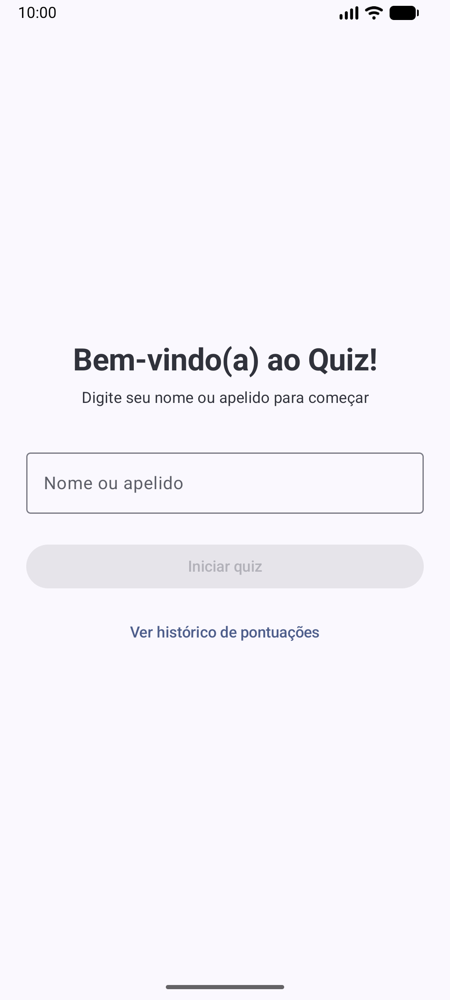
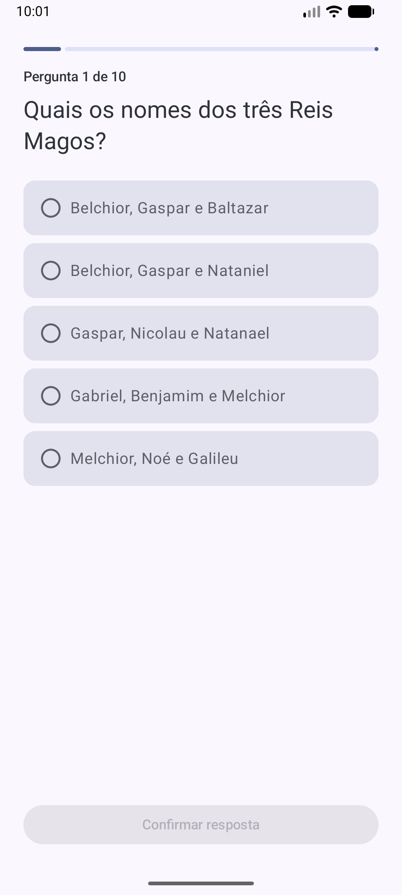
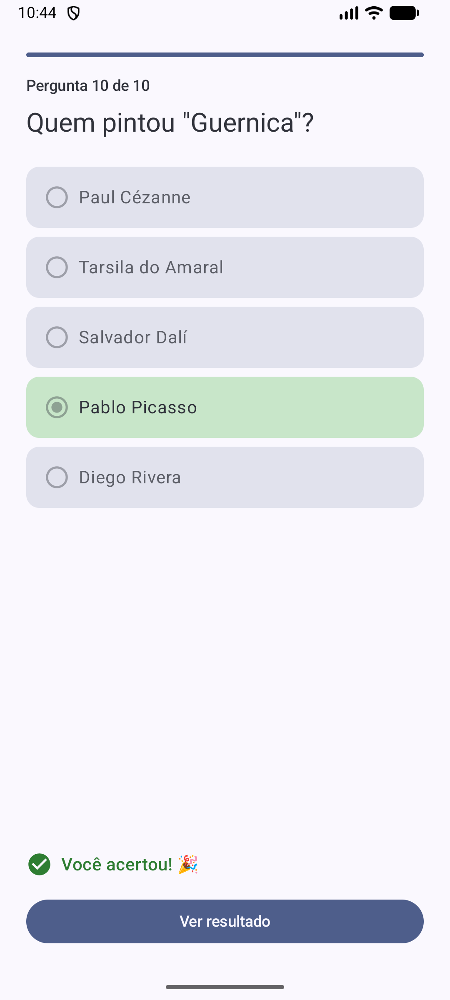
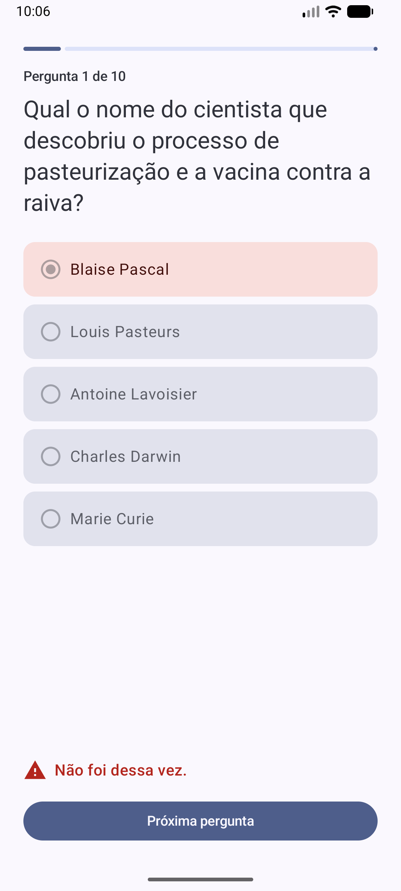
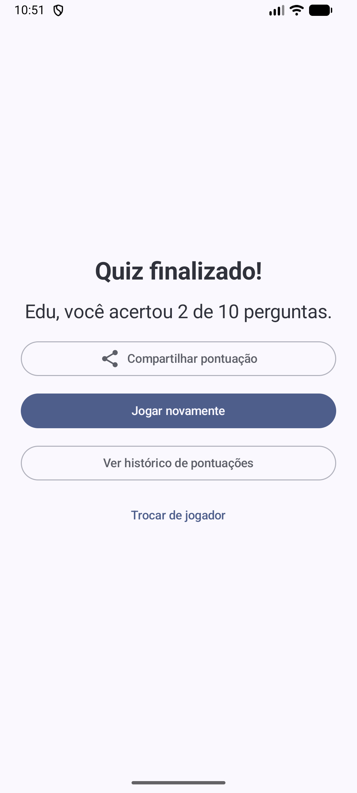
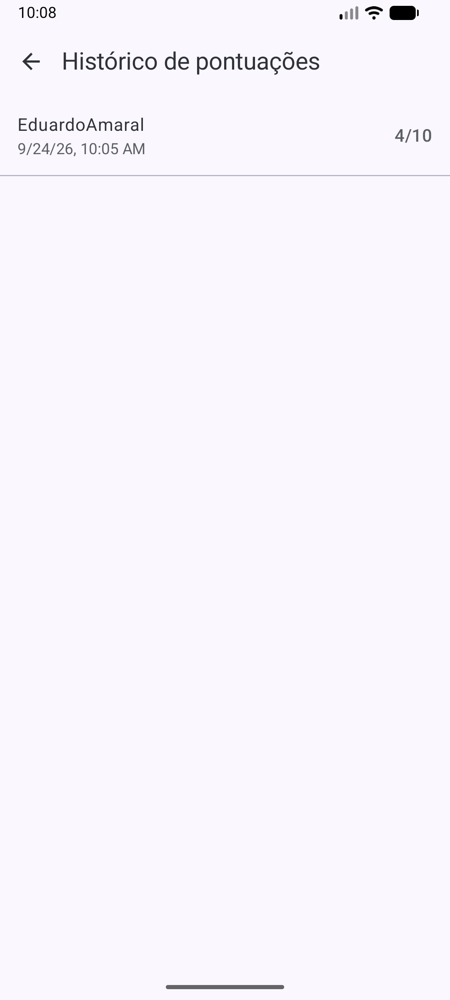
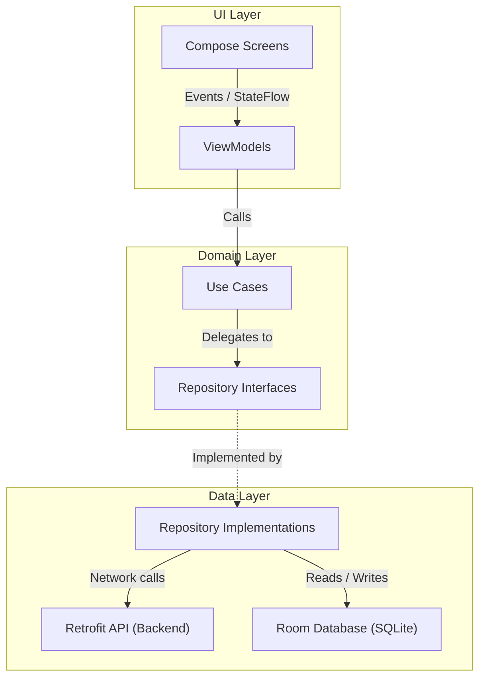

# Android Quiz (Kotlin + Jetpack Compose)

A native Android quiz app: the player enters a name, answers 10 multiple-choice questions
fetched from a REST backend, gets immediate feedback, sees the final score and can browse
every past score. Built in September 2026 for
[Dynamox's Android developer challenge](https://github.com/dynamox-s-a/developer-challenges/blob/main/android-challenge.md)
and kept here as a portfolio piece.

Kotlin 2.4 · Jetpack Compose (Material 3) · MVVM + Clean Architecture · Hilt · Room ·
Retrofit/OkHttp · Coroutines/Flow · JUnit, MockK, MockWebServer, Compose UI tests · detekt · GitHub Actions

| Name entry | Question | Correct | Incorrect | Result | History |
|:-:|:-:|:-:|:-:|:-:|:-:|
|  |  |  |  |  |  |

## Highlights

- MVVM on top of three layers (`ui` / `domain` / `data`); `domain` has no Android, Retrofit or Room imports.
- Screen state is a `sealed interface` (`Loading`, `InProgress`, `Error`), rendered by stateless composables.
- Quiz progress survives process death through `SavedStateHandle`, not just rotation.
- Typed errors (`AppError`) at the data boundary; the UI never sees HTTP codes or exceptions.
- A use case avoids repeated questions from a backend that returns them at random.
- HTTP retry only for idempotent `GET` requests, to absorb the backend's cold start.
- Tests at four levels: JVM unit tests with fakes and MockK, MockWebServer at the HTTP edge,
  Room on a device, and Compose UI tests on the stateless screen.
- detekt and a GitHub Actions workflow run on every push.

## Architecture



`ui` depends on `domain` through Hilt-injected use cases; `data` implements the `domain`
repository interfaces with Retrofit and Room. One use case per business operation, one
ViewModel per screen, immutable `QuizSession` value for quiz progress.

## Key decisions

- **Retry only idempotent requests.** `RetryInterceptor` retries `GET` up to twice on
  `IOException` because the backend runs on Cloud Run and cold starts drop the first call.
  `POST /answer` is never retried: after a network failure there is no way to know whether
  the first attempt was processed.
- **Retry replays the operation that failed.** `QuizUiState.Error` carries a `RetryAction`
  (`LoadQuestion` or `SubmitAnswer(question, option)`). A failed submission keeps the
  question the player already saw instead of fetching a new one.
- **Process death is handled, with a bounded loss.** `answeredCount`, `correctCount` and
  `seenQuestionIds` are saved to `SavedStateHandle` after every answer. The in-flight
  question is not (only its id would be recoverable), so a restore re-fetches one question.
- **Duplicate questions are a domain rule.** `GET /question` is random and may repeat within
  a run. `GetUniqueQuestionUseCase` retries up to 5 times on a seen id, then accepts the
  repeat rather than trapping the player in a loop.
- **Errors are mapped once.** `safeApiCall` turns Retrofit/OkHttp failures into
  `AppError` (`Network`, `BadRequest`, `NotFound`, `ServerError`, `Unknown`). It deliberately
  does not catch blanket `Exception`, so `CancellationException` keeps propagating. The real
  backend answers an unknown `questionId` with a plain-text 400; the mapper only reads the
  status code, and that case is covered by a MockWebServer test.
- **Guards against double taps.** Submitting and advancing are ignored while the previous
  call is in flight; otherwise two coroutines race on the same `QuizSession` and the last
  question can be saved twice.
- **No ViewModel where there is no logic.** `NameEntryScreen` keeps its text field in
  `rememberSaveable`, which already survives rotation and process death.

## Tests

| Layer | Double | Example |
|---|---|---|
| ViewModel | Hand-written fakes (`FakeQuizRepository`, `FakeScoreRepository`), Turbine | `app/src/test/.../ui/quiz/QuizViewModelTest.kt` |
| Use case | MockK | `app/src/test/.../domain/usecase/GetUniqueQuestionUseCaseTest.kt` |
| Repository, interceptor | MockWebServer against the real Retrofit/OkHttp stack | `app/src/test/.../data/repository/QuizRepositoryImplTest.kt`, `data/remote/RetryInterceptorTest.kt` |
| Room DAO | Real SQLite on a device (instrumented) | `app/src/androidTest/.../data/local/PlayerScoreDaoTest.kt` |
| Compose UI | `createComposeRule` on the stateless `QuizContent`, no Hilt | `app/src/androidTest/.../ui/quiz/QuizScreenTest.kt` |

```bash
./gradlew testDebugUnitTest            # JVM unit and MockWebServer tests
./gradlew connectedDebugAndroidTest    # Room and Compose UI tests (device or emulator)
./gradlew detekt                       # static analysis
```

## Getting started

Requirements: JDK 17, Android SDK with platform 37, a device or emulator on API 26+.

```bash
git clone https://github.com/eduarduamaral/android-quiz-compose.git
cd android-quiz-compose
./gradlew installDebug
```

Or open the folder in Android Studio and run the `app` configuration. No API keys: the
backend base URL is in `di/NetworkModule.kt`.

## License

[MIT](LICENSE). Originally submitted as
[dynamox-s-a/developer-challenges#239](https://github.com/dynamox-s-a/developer-challenges/pull/239).
